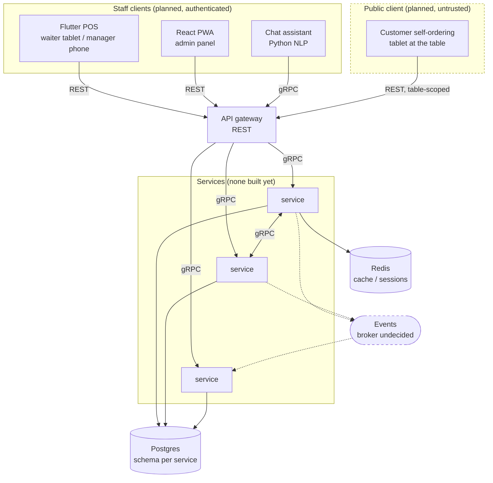

# Architecture overview

How the system is put together today, and the shape the rest of it is meant to
grow into. For *why* any of it is this way, see
[`decisions/`](decisions/).

> **Reality check.** Only the Go foundation (`pkg/`, `api/`) and the local stack
> exist. No business service has been written. Everything marked *planned* comes
> from [`../preconception.md`](../preconception.md) and is intent, not code.

## The shape



Solid lines are request/response; dashed lines are events. The dashed broker is
not built — see [ADR 0004](decisions/0004-defer-message-broker-choice.md).

## Transports

Three, each for a different job
([ADR 0003](decisions/0003-transport-split.md)):

| Transport | Between | For |
| --- | --- | --- |
| REST / JSON | client → gateway | everything a client does; the only public surface |
| gRPC | service ↔ service | anything the caller needs an answer to |
| Events | service → service | anything that must not be lost and must not block the caller |

A service never calls another service's database, and a client never talks to a
service directly.

**Not all clients are equal.** Three are used by authenticated employees and
carry a JWT identifying a person. The customer self-ordering tablet carries
neither: it sits in the dining room, handled by the public, with no person
behind the request. It therefore gets its own narrow REST surface, scoped to one
table's order and exposing no staff operation — not the staff API with a guest
role added. Treat it as internet-facing even though the device never leaves the
building. See [`../requirements/non-functional.md`](../requirements/non-functional.md)
`NFR-016`.

**Contracts.** `api/proto` is the source of truth for every RPC. Go code is
generated with `make proto` into `api/gen`, which is not committed — the `.proto`
files are the artifact under review, not their output. `api/` is its own module
so a service depends on the contracts without depending on `pkg/`.

## Errors

One vocabulary, defined once in `pkg/errs` and translated at each boundary
([ADR 0005](decisions/0005-shared-error-vocabulary.md)):

```
repository ──┐
service    ──┼──> errs.Error{Kind, Code, Message, Fields}
domain     ──┘            │
                          ├── httpx.Fail        → HTTP status + JSON body
                          ├── grpcx.Status      → gRPC status code
                          └── grpcx.FromStatus  → back to errs.Error
```

A `NotFound` raised in a repository reaches an HTTP client as 404 and a gRPC
caller as `codes.NotFound`, and if that caller is another service it arrives
back as `errs.KindNotFound` — so meaning survives a hop. Internal errors are the
exception: their cause is logged and never serialised, so a SQL string cannot
leak to a client.

Nothing below the transport layer imports `net/http` or `grpc`.

## Data

One Postgres instance, one schema per service, one shared Redis
([ADR 0002](decisions/0002-postgres-schema-per-service.md)).

A service reads and writes only its own schema. The DSN pins `search_path` to
that schema, so an unqualified query that reaches for another service's table
fails rather than succeeding quietly. Cross-service reads go through gRPC.

Redis is shared, with keys namespaced per service by `redisx.NewNamespace`, so
two services cannot collide on a key. It is a soft dependency: a cache miss and
a cache outage both have to leave the service working.

**Migrations** live with the service that owns them, in
`services/<name>/migrations`, each with its own `schema_migrations_<name>` table.
A service's first migration creates its schema, so adding a service needs no
change to any shared bootstrap.

## Repository structure

A monorepo of several Go modules tied together by a committed `go.work`
([ADR 0001](decisions/0001-monorepo-multi-module.md)). `pkg/` and `api/` are
modules; each service will be one too, so a service builds and deploys without
pulling in its siblings.

See the root [`README.md`](../../README.md#layout) for the directory tree.

## Cross-cutting concerns

**Configuration** comes from the environment only, no files. A service embeds
`config.Base` and adds the dependency blocks it uses; `config.Load` fails at
startup when something required is missing, rather than on first use.

**Logging** is `log/slog`, structured, JSON outside local development. The
logger is carried on `context.Context`, so a repository logs with the same
request-scoped fields as the handler that called it.

**Request correlation.** Every request carries `x-request-id`, adopted from the
caller or generated at the edge, propagated through gRPC metadata, attached to
every log line, and included in error responses. One client call is traceable
across every service that touched it.

**Lifecycle.** `app.Runner` supervises a service's long-lived components and
stops them in reverse registration order under one shared deadline, so
dependents shut down before their dependencies.

**Health.** `/healthz` answers while the process lives; `/readyz` runs the
registered dependency checks and returns 503 while any fails. A failing
dependency should remove a service from the load balancer, not get it restarted.

## Not yet designed

Listed so their absence is visible rather than assumed:

- Authentication and the RBAC permission matrix
- Service boundaries and the domain model
- Payments and fiscal receipt obligations
- Offline behaviour for the POS client
- Deployment target, environments, CI

See [`../preconception.md`](../preconception.md#open-questions).
