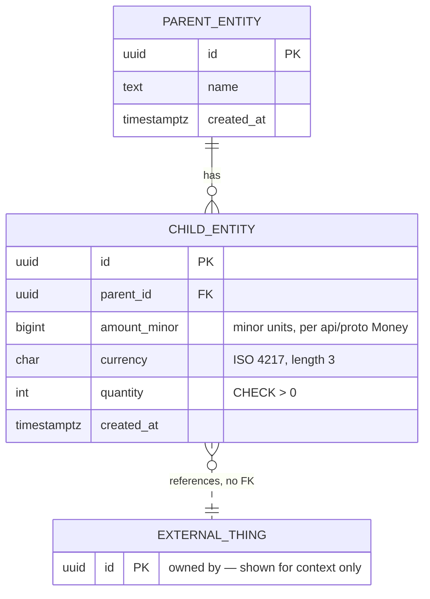

# Schema design: `<service_name>`

> **How to use this.** Copy to `docs/database/<service>-schema.md` and fill it
> in. Part A is requirements — finish it before modelling anything. Part B is
> the design that answers Part A, expressed as an **ER diagram, not SQL**. Part C
> is the review gate. Part D is how the accepted design reaches the codebase.
>
> **No DDL in this document.** SQL belongs in the migration files, generated from
> the accepted model. Keeping it out of here stops the diagram and the DDL
> disagreeing, which they always eventually do.
>
> If a Part A row is empty, the matching Part B decision is a guess. Leave it
> marked `?` rather than inventing a figure; an honest unknown is reviewable, a
> fabricated number is not.
>
> Theory and rationale for every choice here: [`design-theory.md`](design-theory.md).

| | |
| --- | --- |
| **Service / schema** | `<service_name>` |
| **Owner** | `<who maintains this>` |
| **Status** | Draft / In review / Accepted / Superseded |
| **Date** | `YYYY-MM-DD` |
| **Related ADRs** | [ADR 0002](../architecture/decisions/0002-postgres-schema-per-service.md), `<others>` |

---

# Part A — Requirements

## A1. Purpose

<!-- Two sentences. What business capability does this schema own? If you
     cannot say it without "and", it may be two services. -->

## A2. Requirements served

Trace to [`../requirements/functional.md`](../requirements/functional.md) and
[`../requirements/non-functional.md`](../requirements/non-functional.md). A
table that serves no listed requirement needs justifying.

| Requirement | What the schema must support | Status of that requirement |
| --- | --- | --- |
| `FR-0??` | | Captured / Inferred / Open |
| `NFR-0??` | | |

**Open requirements this design is exposed to:** `<list them>`
<!-- Name them explicitly. If an Open requirement would reshape these tables,
     say so here — it is the difference between a design and a gamble. -->

## A3. Aggregates and transaction boundaries

The test: **what must change together, atomically, or the data is wrong?**
Everything inside one aggregate lives in this schema and can be written in one
transaction. Everything outside is another service's problem.

| Aggregate | Root entity | Members | Invariant that forces them together |
| --- | --- | --- | --- |
| | | | |

**Explicitly outside this boundary:** `<entities this schema references but does
not own>`

## A4. Access patterns

**The most important section in this document.** Indexes, keys and
denormalisation decisions are all answers to this table — fill it in before
Part B, or the indexes in Part B are decoration.

| # | Operation | Read or write | Trigger | Frequency | Latency it needs | Filters / sorts on |
| --- | --- | --- | --- | --- | --- | --- |
| 1 | | R / W | `<which client, which FR>` | `<per service / per day>` | | |

Note the **hot path** explicitly: the one or two operations that run constantly
during a service period. Optimise for those; everything else just has to work.

## A5. Volume and growth

| Entity | Rows at launch | Growth rate | Rows after 3 years | Notes |
| --- | --- | --- | --- | --- |
| | | | | |

<!-- Order of magnitude is enough. The point is to know whether you are
     designing for thousands or hundreds of millions — they are different
     designs, and guessing wrong in either direction costs. -->

## A6. Consistency and durability

| Question | Answer |
| --- | --- |
| Is any data here financial or legally retained? | |
| Acceptable loss window if the database is restored from backup | |
| Can any of this be rebuilt from another source? | |
| Does anything need to be append-only? | |

## A7. Retention and deletion

| Entity | Kept for | Then what | Driven by |
| --- | --- | --- | --- |
| | | Archive / aggregate / delete | `NFR-021` / legal / product |

**Can any row be hard-deleted?** `<usually no, for anything another record
references — see Part C>`

## A8. Who else needs this data

Cross-service reads are gRPC calls, never queries
([ADR 0002](../architecture/decisions/0002-postgres-schema-per-service.md)).

| Consumer | What it needs | How it gets it | Can it tolerate staleness? |
| --- | --- | --- | --- |
| `<service / client>` | | RPC / event / cached projection | |

---

# Part B — Design

## B1. Schema and ownership

- **Schema name:** `<service_name>` — created by this service's first migration
- **`search_path`** is pinned to it by `config.Postgres.DSN()`
- **No other service** reads or writes these tables

## B2. Entities

| Table | Holds | Aggregate | Append-only? |
| --- | --- | --- | --- |
| | | | |

## B3. Entity diagram

Model the schema as an ER diagram, not as SQL. The DDL is generated from this
later, in the migration — designing in SQL too early turns a modelling
conversation into a syntax one, and makes the diagram the thing nobody updates.

Use a Mermaid `erDiagram`, so the model lives in this file, diffs in review and
renders on GitHub.

### Notation

| Cardinality | Meaning |
| --- | --- |
| `\|\|--o{` | one to zero-or-more |
| `\|\|--\|{` | one to one-or-more |
| `\|\|--\|\|` | one to exactly one |
| `\|o--o\|` | zero-or-one to zero-or-one |
| `}o--o{` | many to many — usually means a missing join entity |

| Line | Meaning |
| --- | --- |
| `--` solid | **Identifying.** The child cannot exist without the parent, and both are in this schema. A real foreign key. |
| `..` dashed | **Non-identifying.** Use for every reference that crosses a service boundary: there is no foreign key, nothing enforces it (B9). |

Key markers: `PK` primary, `FK` foreign, `UK` unique.

### The model



Rules for the diagram:

- **Include every entity this schema owns, and nothing it does not.** An entity
  from another service appears only when a reference to it needs explaining, and
  is labelled as foreign.
- **Types are the real ones** — `timestamptz` not `datetime`, `bigint` for money
  minor units, `date` for a business date. The diagram is a specification, not a
  sketch.
- **Put short constraints in the quoted comment** (`"CHECK > 0"`,
  `"snapshot at order time"`). Longer rules go in B4 and B7.
- **A many-to-many is a smell.** It almost always hides an entity with
  attributes of its own — a join row usually wants a quantity, a timestamp or a
  price.

### Entity notes

For anything the diagram cannot carry:

| Entity / attribute | Note |
| --- | --- |
| | default, invariant, unit, why this type, why nullable |

<!-- NULL deserves care: say what it means. "Unknown" and "not applicable" are
     different facts and should not share a column. -->

## B4. Normalisation

Normalisation means each fact lives in exactly one place, so it cannot be
updated in one row and left stale in another. Work to **3NF**, then deviate only
deliberately and only for a reason listed below.

Full treatment: [`design-theory.md`](design-theory.md#4-normalisation-and-when-to-stop).

### The checks

Walk the diagram and answer each question. The point is the *exception* column —
a form that holds everywhere needs one line; one that does not needs a reason.

| Form | Question to ask of every entity | Holds? | Where it does not, and why |
| --- | --- | --- | --- |
| **1NF** | Is every attribute a single atomic value? No comma-separated lists, no `JSONB` standing in for rows, no `phone1`/`phone2`/`phone3`? | | |
| **2NF** | With a composite key, does every non-key attribute depend on *all* of it, not just part? (No composite key → 2NF is automatic.) | | |
| **3NF** | Does any non-key attribute depend on another non-key attribute rather than on the key? (Storing `city` beside `postcode`, or a `total` derived from child rows.) | | |

The 3NF question is the one that catches real bugs. If `B` is determined by `A`
and both are non-key, then changing `A` obliges you to remember to change `B` —
and one day nobody will.

### Deliberate deviations

Only three reasons are acceptable. Anything else means going back to 3NF.

| # | What is duplicated or derived | Reason | How inconsistency is prevented |
| --- | --- | --- | --- |
| 1 | | temporal snapshot / measured read pattern / cross-service copy | |

**Temporal snapshot is not a 3NF violation, and this is worth being precise
about.** `unit_amount_minor` on an order line is not a copy of the menu item's
price — it is *the price this customer was charged*, which is a different fact
that happens to have had the same value once. The menu price can change
afterwards and the order line must not. So it is not redundant data, and the
rule "one fact, one place" is intact.

The test for whether a duplicate is a legitimate snapshot: **if the source
changes, must this change too?** If no, it was never the same fact. If yes, it is
redundancy and belongs in one place.

For the other two reasons:

- **A measured read pattern** needs the measurement. `EXPLAIN (ANALYZE)` on
  realistic volumes, not an intuition about what will be slow.
- **A cross-service copy** needs a named staleness tolerance and a refresh
  mechanism (B9, B10), or it silently rots.

## B5. Keys and identifiers

| Decision | Choice | Why |
| --- | --- | --- |
| Primary key type | `UUID` / `BIGINT` | |
| Generated where | database `uuidv7()` / application | |
| Any natural key with a `UNIQUE` constraint? | | |
| Any client-supplied idempotency key? | | `NFR-001` makes retries certain where a client can be offline |

## B6. States and enumerations

Use `TEXT` with a `CHECK` constraint, not a Postgres `ENUM` — see
[the theory doc](design-theory.md#enumerations).

| Column | Allowed values | Legal transitions | Enforced where |
| --- | --- | --- | --- |
| | | | DB `CHECK` / application / both |

<!-- Distinguish carefully: a domain state (an item is "86" / unavailable) is
     NOT the same column as a lifecycle flag (an item is archived). Conflating
     them is a recurring bug. -->

## B7. Invariants: database or application?

Put it in the database when a bug must not be able to violate it.

| Invariant | Enforced by | Why there |
| --- | --- | --- |
| | `CHECK` / `UNIQUE` / `FK` / trigger / application | |

## B8. Indexes

**Every index needs an access pattern from A4, by number.** An index with no
listed pattern is write cost with no reader.

| Index | Columns | Type | Serves pattern | Notes |
| --- | --- | --- | --- | --- |
| | | B-tree / partial / GIN | A4 #? | |

Leading-column rule: a composite index on `(a, b)` serves queries filtering on
`a`, or `a` and `b` — never `b` alone.

## B9. Cross-schema references

No foreign keys cross a schema boundary, so these are bare `UUID` columns with
nothing enforcing them.

| Column | Points at | Integrity strategy | What happens if the target vanishes |
| --- | --- | --- | --- |
| | `<service>.<table>` | validate on write via gRPC / accept eventual / snapshot the data | |

**Snapshotted data** — fields copied in at write time rather than referenced,
so history cannot be rewritten:

| Column | Copied from | Why it is snapshotted |
| --- | --- | --- |
| | | |

## B10. Events

The event payloads this schema's changes produce. The broker is undecided
([ADR 0004](../architecture/decisions/0004-defer-message-broker-choice.md)), but
the **outbox table is broker-agnostic** and can be designed now.

| Event | Emitted when | Payload | Consumers |
| --- | --- | --- | --- |
| | | | |

- **Outbox table:** yes / no — required if an event must never be lost when the
  state change commits
- Consumers must be idempotent: delivery is at-least-once

## B11. Concurrency

| Question | Answer |
| --- | --- |
| Can two clients write the same row at once? | |
| Strategy | optimistic (`version`) / pessimistic (`FOR UPDATE`) / none needed |
| Isolation level | Read Committed (default) / Repeatable Read / Serializable |
| What a conflict looks like to the user | |

<!-- Concrete example in this system: FR-101 lets a guest add to their table's
     order from the tablet while a waiter edits the same order. Decide what the
     loser of that race sees. -->

## B12. Migrations

Files live in `services/<service>/migrations`, tracked in
`schema_migrations_<service>`. Applied with
`make migrate-up SERVICE=<service>`.

| # | File | Does |
| --- | --- | --- |
| 1 | `000001_create_schema.up.sql` | `CREATE SCHEMA` + initial tables |

- **Expand/contract needed?** yes / no — required for any change that is not
  purely additive, if the service is already deployed
- **Backfill plan:** `<for any new NOT NULL column on an existing table>`

## B13. Open questions

| # | Question | Blocks | Who decides |
| --- | --- | --- | --- |
| 1 | | | |

---

# Part C — Review checklist

Project-specific traps. Every line gets a tick or an explicit, written
exception — "n/a" is a valid answer, silence is not.

**Money and numbers**

- [ ] No `FLOAT`, `REAL` or `DOUBLE PRECISION` anywhere near money
- [ ] Money is `BIGINT` minor units + ISO 4217 code, matching `api/proto` `Money`
- [ ] Quantities that can be fractional (weights, measures) use `NUMERIC`, not float

**Time**

- [ ] Every timestamp is `TIMESTAMPTZ`, never `TIMESTAMP`
- [ ] Anything reported "per day" has an explicit `business_date` column — a
      restaurant's service day does not end at midnight, so a date derived from
      a timestamp splits one service across two days
- [ ] Clear on which timestamps are *when it happened* versus *when we recorded it*

**History and deletion**

- [ ] Nothing another record references can be hard-deleted
- [ ] Price, name and anything else a customer saw is **snapshotted** onto the
      transaction, never read live from master data — otherwise repricing a dish
      silently rewrites last month's revenue
- [ ] Financial records are append-only: a correction is a new row, never an
      `UPDATE` or `DELETE`
- [ ] Soft-delete / archive flags are separate columns from domain states

**Boundaries**

- [ ] No foreign key crosses a schema boundary
- [ ] Every cross-schema `UUID` has a named integrity strategy (B9)
- [ ] No query in this service reads another service's tables
- [ ] Nothing here duplicates another service's data except deliberate snapshots

**Correctness under load and failure**

- [ ] Rows writable from two clients carry a `version` column
- [ ] Any write a client might retry has an idempotency key with a `UNIQUE`
      constraint — offline clients *will* resend (`NFR-001`)
- [ ] Events that must not be lost go through an outbox in the same transaction
- [ ] Unique constraints exist in the database, not only in application code

**Model**

- [ ] The ER diagram covers every entity this schema owns, and no entity it does not
- [ ] Attribute types in the diagram are the real Postgres types
- [ ] Cross-boundary references are drawn with a dashed, non-identifying line
- [ ] No many-to-many relationship survives without a join entity of its own
- [ ] 3NF reached, or every deviation listed in B4 with one of the three reasons
- [ ] Every snapshot passes the test: if the source changes, this must *not*
- [ ] Every `NULL`-able column has a stated meaning for `NULL`

**Hygiene**

- [ ] Every index traces to a numbered access pattern
- [ ] `snake_case` throughout; table names plural, columns singular
- [ ] Every table has `created_at`; mutable tables have `updated_at`
- [ ] The migration runs on an empty database *and* on a populated one
- [ ] `make migrate-up` then `make migrate-down` leaves no debris

---

# Part D — Connecting to the project

How an accepted design becomes running code. Nothing here is decided per
schema — it is the same wiring every service uses, recorded so the design hands
over without a conversation.

## D1. Where it lands

```
services/<service>/
  migrations/                     the DDL, generated from the B3 model
    000001_create_schema.up.sql
    000001_create_schema.down.sql
  internal/domain/                entities from B3, as Go types
  internal/repository/            the SQL, one file per aggregate
  internal/service/              business rules; never writes SQL
```

The B3 diagram maps onto `internal/domain`: one aggregate root per file, its
members alongside. Domain types import nothing from `pkg/postgres` — if they
need a `pgx` tag to persist, the boundary has leaked.

## D2. Creating the migration

The first migration creates the schema itself, so the service is deployable
without anyone preparing the database by hand:

```bash
make migrate-new SERVICE=<service> NAME=create_schema
# then write the DDL from the B3 model into the generated .up.sql
make migrate-up SERVICE=<service>
```

Migrations are tracked per service in `schema_migrations_<service>`, so services
migrate independently.

## D3. How the service connects

`config.Postgres` reads these from the environment — see `.env.example`:

| Variable | Local value | Notes |
| --- | --- | --- |
| `POSTGRES_HOST` / `POSTGRES_PORT` | `localhost` / `5432` | |
| `POSTGRES_USER` / `POSTGRES_PASSWORD` | `restaurant` / `restaurant` | |
| `POSTGRES_DB` | `restaurant` | one database for all services |
| `POSTGRES_SCHEMA` | `<service>` | **this schema** — becomes the `search_path` |
| `POSTGRES_MAX_CONNS` / `MIN_CONNS` | `10` / `2` | one instance is shared; do not be greedy |

```go
cfg, err := config.Load[Config]()          // embeds config.Base + config.Postgres
pool, err := postgres.Connect(ctx, cfg.Postgres)
defer pool.Close()
```

`Connect` pings before returning, so a bad configuration fails at startup rather
than on the first request. `DSN()` pins `search_path` to `POSTGRES_SCHEMA`, which
is what makes the B9 boundary real: an unqualified query reaching for another
service's table fails instead of quietly succeeding.

## D4. Repositories

Take `postgres.Pool`, not `*pgxpool.Pool`. The interface carries `Exec`, `Query`
and `QueryRow`, which both the pool and an open transaction satisfy — so the
same method works inside and outside a transaction, and a test can pass a fake.

```go
type MenuRepository struct{ db postgres.Pool }

func (r *MenuRepository) ByID(ctx context.Context, id uuid.UUID) (domain.MenuItem, error) {
    // ... QueryRow, Scan
    if err != nil {
        return domain.MenuItem{}, postgres.MapError(err, "menu item")
    }
    return item, nil
}
```

Write the column list out; never `SELECT *`. A migration that adds a column
should not change what existing code reads.

## D5. Errors

Pass every driver error through `postgres.MapError(err, "<resource>")`. It turns
Postgres conditions into the domain vocabulary, so nothing above the repository
knows about SQL state codes:

| Postgres | Becomes | Reaches a client as |
| --- | --- | --- |
| no rows | `errs.NotFound` | HTTP 404 / gRPC `NotFound` |
| unique violation `23505` | `errs.Conflict` | HTTP 409 / `AlreadyExists` |
| FK violation `23503` | `errs.InvalidInput` | HTTP 400 / `InvalidArgument` |
| check / not-null | `errs.InvalidInput` | HTTP 400 / `InvalidArgument` |
| anything else | `errs.Internal` | HTTP 500, cause logged and never sent |

This is why B7 matters: a constraint in the database becomes a correct client
error for free, while the same rule in application code has to be hand-mapped.

The resource name becomes the client-facing message, so write it as a noun a
user would recognise — `"menu item"`, not `"menu_items row"`.

## D6. Transactions

An aggregate from B3 is written in one transaction:

```go
err := postgres.InTx(ctx, pool, func(tx pgx.Tx) error {
    // pgx.Tx satisfies postgres.Pool, so a repository built over the
    // transaction is the same type as one built over the pool — no second
    // code path for transactional writes.
    repo := repository.NewOrders(tx)

    if err := repo.Insert(ctx, order); err != nil {
        return err
    }
    return repo.InsertLines(ctx, order.ID, order.Lines)
})
```

That substitution is the reason repositories take the interface rather than
`*pgxpool.Pool`, and it is asserted in `pkg/postgres/pool_test.go` so it cannot
quietly stop being true.

`InTx` commits on `nil`, rolls back on an error or a panic, and uses
`context.WithoutCancel` for the rollback so an already-cancelled context cannot
leave a transaction open. If an operation spans two aggregates, that is
a signal the B3 boundaries may be wrong — or that it needs an outbox (B10)
rather than one transaction.

## D7. Readiness

Register the pool so `/readyz` reports it, and the service leaves the load
balancer when its database is unreachable instead of failing requests:

```go
checker := health.New(2 * time.Second)
checker.Register("postgres", func(ctx context.Context) error {
    return pool.Ping(ctx)
})
checker.Mount(engine)
```

Keep the check to a ping. A readiness probe that runs a real query turns every
probe interval into load.

## D8. Verifying it locally

```bash
make up                                  # Postgres and Redis
make migrate-up SERVICE=<service>        # apply this schema
make test                                # unit tests, no database
make test-integration                    # against the live stack
```

Integration tests belong behind the `integration` build tag, as in
`pkg/integration`. Prove the migration applies to an empty database *and* to a
populated one — and that the constraints from B7 actually reject what they
should, which is the only way to know the model survived translation into SQL.
